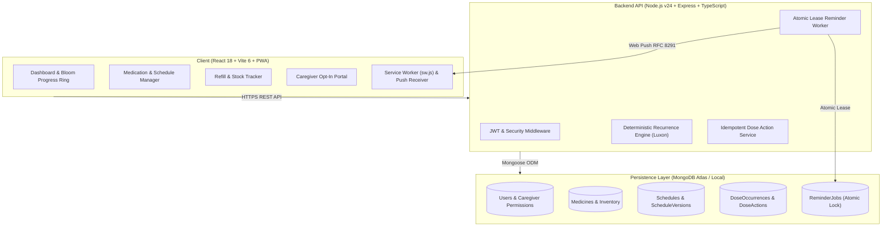

# 🌸 DOSEBLOOM — Smart Medicine Reminder & Daily Dose Tracker

> **"A little reminder. A healthier routine."**  
> A full-stack, production-ready MERN Progressive Web Application (PWA) designed to organize user-prescribed medication regimens, deliver persistent scheduled push reminders, track daily adherence, and manage pharmacy refills with ease.

[](https://nodejs.org)
[](https://www.typescriptlang.org)
[](https://react.dev)
[](https://vitejs.dev)
[](https://tailwindcss.com)
[](https://www.mongodb.com)
[](https://developer.mozilla.org/en-US/docs/Web/Progressive_web_apps)
[](file:///d:/fsd_project/medicine-reminder/server/tests/api.test.ts)

---

## 👨‍🎓 Project & Developer Presentation Details

| Attribute | Details |
|---|---|
| **Project Name** | **DOSEBLOOM** |
| **Developer / Student Name** | `[DEVELOPER_NAME]` |
| **Roll / Registration Number** | `[ROLL_NUMBER]` |
| **Academic Degree & Branch** | `[B.Tech / B.E. / MCA in Computer Science & Engineering]` |
| **Institution / University** | `[COLLEGE_OR_UNIVERSITY_NAME]` |
| **Course Title** | Full-Stack Development (FSD) Capstone Laboratory |
| **Faculty Mentor / Guide** | `[FACULTY_MENTOR_NAME]` |
| **Academic Year** | 2026 |

---

## 🎨 Visual Design System & Palette

DOSEBLOOM pairs a clean, human-centered healthcare aesthetic with a joyful color system, smooth micro-interactions, dark mode, and glassmorphism.

| Color Name | Hex Code | UI Role |
|---|---|---|
| **Emerald** | `#10B981` | Primary brand accent, taken state, success indicators |
| **Indigo** | `#6366F1` | Brand gradient secondary, scheduled state, action buttons |
| **Coral** | `#F59E8B` | Skipped state, gentle attention callouts |
| **Lavender** | `#9B8AFB` | Snoozed state, evening time slot indicators |
| **Mint** | `#B7F7E4` | Morning slot highlight, soft backgrounds |
| **Sky** | `#89D7F7` | Afternoon slot highlight, informational badges |
| **Deep Navy** | `#162238` | Dark mode background and header tone |
| **Cloud** | `#F8FAFC` | Light mode clean canvas |

- **Headings Font:** Space Grotesk (geometric, modern, authoritative)
- **Body Font:** Plus Jakarta Sans (ultra-readable, friendly, clinical clarity)

---

## ⚕️ Healthcare Safety Boundary & Legal Disclaimer

> [!IMPORTANT]
> **Strict Clinical Scope:** DOSEBLOOM is strictly an organizational reminder and self-reporting companion for schedules prescribed by certified medical practitioners.  
> - **DOSEBLOOM NEVER** prescribes medication, recommends dosages, or alters doctor regimens.  
> - **DOSEBLOOM NEVER** automatically doubles missed doses.  
> - **DOSEBLOOM NEVER** provides medical diagnoses or clinical advice.  
> In case of medical emergency, patients are instructed to immediately contact local emergency healthcare services (e.g., Dial 112 in India).

---

## 🏗️ Technical Architecture



### Architecture Highlights
1. **Deterministic Recurrence Engine:** Powered by **Luxon** (`DateTime`), eliminating DST shifts and cross-midnight timezone drift (default `Asia/Kolkata`). Supports Daily, Specific Days of Week, and Interval recurrence.
2. **Atomic Lease-Based Background Worker:** Uses MongoDB `findOneAndUpdate` with lease expiration (`leaseExpiresAt`) to safely execute scheduled reminder dispatches across distributed multi-instance clusters without race conditions or duplicate alerts.
3. **Safe Schedule Versioning:** Editing a schedule archives the active state into `ScheduleVersions`, replaces future un-actioned occurrences, and preserves completed historical records.
4. **Idempotent Dose Actions:** Repeated clicks on "Mark Taken" return the existing confirmation without double-decrementing pharmacy inventory.
5. **DPDP Act 2023 Compliance:** Features lock-screen privacy masking, Section 12 single-click JSON data export, and Section 13 full account erasure.

---

## 🧪 Comprehensive Automated Test Suite

DOSEBLOOM includes an end-to-end integration and unit test suite verified with Node.js test runner:

```bash
npm test
```

### Verified Test Results (21 of 21 Passing)
- **1. System Health & Probes:**
  - `GET /api/health` returns healthy 200 with uptime.
  - `GET /api/ready` verifies live MongoDB connection.
- **2. Authentication & Authorization Security:**
  - Registration with bcrypt salt hashing.
  - Duplicate email rejection with 409 Conflict.
  - Invalid credentials rejection with 401 Unauthorized.
  - Profile retrieval on `GET /api/auth/me`.
  - Unauthenticated access protection on private endpoints.
- **3. Recurrence Engine Unit Tests:**
  - Multi-time daily slot generation.
  - Day-of-week recurrence (Mon/Wed/Fri).
  - Interval-based recurrence (every 2 days).
- **4. Medicine Management & Boundary Isolation:**
  - Medicine creation with coupled schedule and initial inventory.
  - Cross-user tenant isolation (User B cannot access or modify User A's medicine).
- **5. Dose Actions & Inventory Coupling:**
  - Mark Taken decrements stock units automatically.
  - Mark Taken idempotency (repeat clicks do not duplicate deductions).
  - Snoozing updates alert time without altering prescribed schedule.
  - Refill transactions replenish stock and generate audit trails.
- **6. Safe Schedule Versioning:**
  - Schedule edits archive previous version and regenerate only future slots.
- **7. Data Portability & Compliance:**
  - `GET /api/auth/export-data` generates complete, compliant JSON portfolio.

---

## 🚀 Quick Start & Local Setup

### Prerequisites
- **Node.js:** v18.0.0 or higher (v20+ or v24 LTS recommended)
- **MongoDB:** MongoDB Atlas connection string or local MongoDB instance running on `localhost:27017`
- **Git**

### 1. Clone & Install Dependencies
```bash
git clone https://github.com/[YOUR_GITHUB_USERNAME]/medicine-reminder.git
cd medicine-reminder

# Install all workspace dependencies
npm run install:all
```

### 2. Environment Configuration
Verify or create `server/.env`:
```env
PORT=5000
NODE_ENV=development
MONGODB_URI=mongodb://localhost:27017/dosebloom
JWT_SECRET=supersecret_dosebloom_jwt_key_2026_dev_secure
JWT_EXPIRES_IN=7d
CLIENT_URL=http://localhost:5173
VAPID_PUBLIC_KEY=BOMlE8lW6T9p5jV7jD1wQ3kR8sU0xY2zA4bC6dE8fG0hI2jK4lM6nO8pQ0rS2tU4vW6xY8zA0bC2dE4fG6hI8jK
VAPID_PRIVATE_KEY=Pj1kL2mN3oP4qR5sT6uV7wX8yZ9aB0c1dE2fG3hI4jK
VAPID_SUBJECT=mailto:support@dosebloom.app
```

### 3. Seed Demo Data
Populate the database with ready-to-test medications and demo accounts:
```bash
npm run seed --prefix server
```

**Pre-seeded Credentials:**
- **Patient Demo:** `priya@dosebloom.app` / `DemoPass123!`
- **Admin Demo:** `admin@dosebloom.app` / `AdminPass123!`

### 4. Run Development Servers
Start both the Express API and Vite React frontend with live reloading:
```bash
npm run dev
```
- Frontend: `http://localhost:5173`
- Backend API: `http://localhost:5000`

### 5. Build & Run Single Production Server
To run the full-stack app as a single combined deployment:
```bash
# Builds React frontend to client/dist, compiles TypeScript server to server/dist
npm run build

# Start combined production server
npm start
```
Visit `http://localhost:5000/` in your browser!

---

## ☁️ Deployment Guide (Render / Cloud)

DOSEBLOOM is configured for 1-click cloud deployment on [Render](https://render.com) or any containerized host.

### Option A: Combined Web Service (Recommended)
- **Environment:** Node
- **Build Command:**
  ```bash
  npm ci --prefix server --include=dev && npm ci --prefix client --include=dev && npm run build --prefix client && npm run build --prefix server
  ```
- **Start Command:**
  ```bash
  node server/dist/server.js
  ```
- **Health Check Path:** `/api/health`
- **Environment Variables on Render:**
  - `NODE_ENV`: `production`
  - `PORT`: `10000` (or leave default assigned by Render)
  - `MONGODB_URI`: `mongodb+srv://<username>:<password>@cluster.mongodb.net/dosebloom?retryWrites=true&w=majority`
  - `JWT_SECRET`: `[GENERATE_A_64_CHAR_RANDOM_SECRET]`
  - `JWT_EXPIRES_IN`: `7d`
  - `CLIENT_URL`: `https://dosebloom.onrender.com`
  - `VAPID_PUBLIC_KEY`: `[YOUR_VAPID_PUBLIC_KEY]`
  - `VAPID_PRIVATE_KEY`: `[YOUR_VAPID_PRIVATE_KEY]`
  - `VAPID_SUBJECT`: `mailto:admin@dosebloom.app`

### Option B: Dedicated Background Worker (For High Volume)
- Deploy a Render Background Worker pointing to the same repository.
- **Start Command:** `node server/dist/workerRunner.js`

---

## 🧑‍🏫 5-Minute Faculty Demonstration Walkthrough

Follow this scripted walkthrough for high-scoring viva presentations:

1. **Minute 1: Problem & Aesthetics**
   - Open `http://localhost:5000/`.
   - Point out the branding, color tokens, and PWA responsiveness.
   - Mention the strict clinical boundary disclaimer.
2. **Minute 2: Dashboard & Adherence Ring**
   - Click **"Sign In"** -> Click the **"Priya Sharma (Patient)"** one-click demo button.
   - Show the dynamic Daily Progress Bloom Ring and chronological time slots.
3. **Minute 3: Dose Idempotency & Stock Coupling**
   - Click **"Mark Taken"** on a pending dose card (enjoy the confetti celebration 🎉).
   - Click it again to prove idempotency.
   - Navigate to `/refills` to demonstrate that stock decremented automatically.
   - Click **"Log Refill"** to replenish medication inventory.
4. **Minute 4: Calendar Adherence & Safe Schedule Versioning**
   - Navigate to `/calendar` to view the monthly compliance grid.
   - Explain how updating an active schedule archives the previous version while safeguarding past history.
5. **Minute 5: Admin Panel & DPDP Act Data Export**
   - Switch to Admin account (`admin@dosebloom.app`) -> Inspect `/admin` metrics.
   - In `/settings`, click **"Export Health Data"** to demonstrate Section 12 compliance with the Indian DPDP Act 2023.

---

## 📁 Repository Structure

```
medicine-reminder/
├── client/                     # Frontend React + Vite + PWA
│   ├── public/                 # Static assets, web app manifest, sw.js
│   ├── src/
│   │   ├── components/         # Reusable UI components by feature
│   │   │   ├── analytics/      # Recharts adherence dashboards
│   │   │   ├── calendars/      # Medication calendar & history table
│   │   │   ├── caregivers/     # Caregiver opt-in portal
│   │   │   ├── dashboard/      # Daily ring, timeline slots, dose cards
│   │   │   ├── layout/         # Navbar, Sidebar, BottomNav, OfflineBanner
│   │   │   ├── medicines/      # AddMedicineWizard, MedicineCard
│   │   │   ├── notifications/  # Push subscription manager
│   │   │   └── refills/        # Inventory tracker & refill logging
│   │   ├── context/            # AuthContext, ThemeContext
│   │   ├── pages/              # Route pages (Dashboard, Calendar, Settings, Admin, etc.)
│   │   ├── services/           # Axios API client
│   │   ├── types/              # Frontend TypeScript interfaces
│   │   ├── App.tsx             # Route definitions & protected route guards
│   │   └── main.tsx            # React root & QueryClient provider
│   ├── index.html              # HTML5 entry with Space Grotesk typography
│   ├── tailwind.config.js      # DOSEBLOOM color system tokens
│   └── vite.config.ts          # Vite configuration with chunk splitting & proxy
│
├── server/                     # Backend Node.js + Express + TypeScript
│   ├── src/
│   │   ├── bootstrap/          # Idempotent admin initializer & demo seeder
│   │   ├── config/             # Zod environment validator, MongoDB, WebPush
│   │   ├── controllers/        # Route controllers
│   │   ├── middleware/         # Auth, Role, RateLimiter, ErrorHandler
│   │   ├── models/             # Mongoose schemas (15 models)
│   │   ├── notifications/      # WebPush dispatcher with lock-screen privacy
│   │   ├── routes/             # Express API routes mounted on /api
│   │   ├── scheduling/         # Luxon recurrence engine & schedule service
│   │   ├── services/           # Dose action service, inventory service
│   │   ├── validators/         # Zod request payload schemas
│   │   ├── workers/            # Atomic lease ReminderWorker
│   │   ├── app.ts              # Express app definition & SPA static fallback
│   │   ├── server.ts           # HTTP server entry point
│   │   └── workerRunner.ts     # Standalone background worker process
│   ├── tests/                  # 21 automated integration and unit tests
│   └── tsconfig.json           # Server TypeScript configuration
│
├── docs/                       # Technical documentation
│   ├── ARCHITECTURE.md         # Detailed subsystem architecture
│   ├── API_DOCUMENTATION.md    # Complete REST API specification
│   └── FACULTY_DEMO_GUIDE.md   # Viva evaluation script & Q&A
│
└── package.json                # Root workspace configuration
```

---

## 📜 License & Compliance

- **License:** MIT License
- **Healthcare Boundary:** Organizational reminder tool only; not a diagnostic or prescriptive medical device.
- **Data Compliance:** Designed in accordance with the Digital Personal Data Protection (DPDP) Act 2023 (India) and W3C Web Notification standards.
