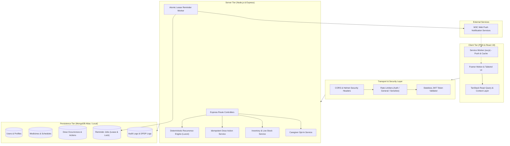

# DOSEBLOOM — System Architecture & Design Specification

> **"A little reminder. A healthier routine."**  
> DOSEBLOOM is a clinical-grade smart medicine reminder and daily dose tracking Progressive Web Application built on the MERN stack with TypeScript.

---

## 1. High-Level Architecture Overview

DOSEBLOOM employs a decoupled client-server architecture with strict layer isolation, deterministic scheduling algorithms, and atomic concurrency controls.



---

## 2. Core Subsystems

### 2.1. Deterministic Recurrence Engine (`server/src/scheduling/recurrence.ts`)
- **Timezone Invariance:** Built using **Luxon** (`DateTime`) to eliminate Daylight Saving Time (DST) jumps, leap years, and regional timezone shifts.
- **Default Locale:** Configured with `Asia/Kolkata` as the default healthcare operating timezone, while accommodating per-user timezone overrides.
- **Supported Patterns:**
  1. `daily`: Generates dose slots at specified clock times (e.g., `08:00`, `14:00`, `20:00`) every day.
  2. `specific_days`: Configurable day arrays (e.g., `[1, 3, 5]` for Mon/Wed/Fri).
  3. `interval`: Interval days pattern (e.g., every 2 days, every 3 days) anchored to `startDate`.
  4. `as_needed` (PRN): User-reported self-administered doses without forced schedule requirements.
- **Dual Representation:** Every occurrence stores both a canonical UTC ISO string (`scheduledAtUtc`) and localized metadata (`scheduledDateLocal`, `scheduledTimeLocal`, and `timeSlot`: `morning`, `afternoon`, `evening`, `night`).

---

### 2.2. Distributed Lease-Based Scheduler (`server/src/workers/reminderWorker.ts`)
To prevent duplicate push notification dispatches across multiple cluster instances or container restarts, DOSEBLOOM implements atomic document leases via MongoDB's `findOneAndUpdate`:

```mermaid
sequenceDiagram
    autonumber
    participant Worker as Reminder Worker
    participant DB as MongoDB (ReminderJobs)
    participant WebPush as WebPush Service
    participant Client as User Device PWA

    loop Every 15 Seconds
        Worker->>DB: findOneAndUpdate({ status: 'pending', scheduledForUtc <= now, leaseExpiresAt <= now }, { $set: { status: 'claimed', lockedBy: workerId, leaseExpiresAt: now + 30s } })
        alt Lease Claimed Successfully
            Worker->>WebPush: Dispatch push notification (VAPID authenticated)
            alt Push Delivered (201 Created)
                Worker->>DB: updateOne({ status: 'sent', sentAtUtc: now })
                WebPush->>Client: Show push banner (with privacy redaction)
            else Subscription Gone (404/410)
                Worker->>DB: Remove dead PushSubscription record
                Worker->>DB: updateOne({ status: 'failed', error: 'Subscription Expired' })
            else Transient Network Failure
                Worker->>DB: Increment retryCount; if retries < 3, reschedule with backoff
            end
        else No Eligible Jobs
            Worker->>Worker: Sleep for 15s
        end
    end
```

---

### 2.3. Safe Schedule Versioning & History Preservation
A key healthcare requirement is that **modifying a future dosage or schedule must never rewrite past medical history**.
1. When a user updates a schedule:
   - The current schedule configuration is archived as a immutable snapshot in `ScheduleVersions`.
   - Existing occurrences in `taken` or `skipped` states remain permanently untouched.
   - Future occurrences in `scheduled` status are safely superseded.
   - New `DoseOccurrences` and `ReminderJobs` are generated starting from the update timestamp through the lookahead horizon.
2. Version lineage is tracked via `versionNumber`, `effectiveFromUtc`, and `scheduleVersionId`.

---

### 2.4. Idempotent Dose Actions & Inventory Coupling
- **Mark Taken:**
  - Idempotent: Executing "Mark Taken" multiple times on the same dose occurrence returns the existing action without deducting inventory twice.
  - Automatically decrements the medicine's `currentStockUnits` by the prescribed `doseQuantity`.
  - Flags `isLowStock: true` when stock drops below `lowStockThresholdUnits`.
- **Mark Skipped:**
  - Records clinical reason for skipping (e.g., "physician advised", "fasting", "nauseous").
  - Does **not** deduct medication inventory.
- **Snooze:**
  - Defers the notification alert by 15, 30, or 60 minutes without modifying the underlying schedule or prescribed occurrence time.
- **Audited Corrections:**
  - If a patient mistakenly marks a dose, an audited correction allows state modification while logging an immutable entry in `AuditLogs` preserving timestamp, user IP, and previous state.

---

### 2.5. Caregiver Opt-In Federation
- Patients can invite trusted family members or caregivers by entering their email.
- Generates a cryptographically secure 256-bit token with a 72-hour expiry.
- Upon acceptance, permissions are granted under an explicit opt-in model:
  - `view_history`: Monitor completed and skipped doses.
  - `receive_alerts`: Receive push notifications when a dose is missed by >30 minutes.
  - `manage_schedules`: (Optional) Assist in adjusting calendar dosage.
- Patients retain the unconditional ability to revoke caregiver permissions at any second.

---

### 2.6. Privacy & DPDP Act Compliance
- **Lock-Screen Privacy:** When `lockScreenPrivacy` is enabled, push notifications omit medicine names (e.g., "Time for your scheduled morning dose" instead of "Take 500mg Metformin").
- **Right to Data Portability (Section 12, DPDP Act 2023):** Single-click export (`GET /api/auth/export-data`) packages all user profiles, medications, schedules, dose actions, and inventory logs into a clean JSON bundle.
- **Right to Erasure (Section 13, DPDP Act 2023):** Irrevocable account deletion (`DELETE /api/auth/account`) purges all associated collections and active push registrations.

---

## 3. Technology Stack & Key Dependencies

| Component | Technology | Rationale |
|---|---|---|
| Runtime | Node.js v20+ / v24 (LTS) | High-throughput asynchronous I/O |
| Language | TypeScript 5.7+ | Full end-to-end type safety |
| Framework | Express.js 4.21+ | Battle-tested HTTP routing & middleware |
| Database | MongoDB Atlas / Local v7/8/9 | Flexible document model with atomic updates |
| ODM | Mongoose 8.9+ | Strict schema enforcement and validation |
| Date/Time | Luxon 3.5+ | Timezone and DST safe datetime calculations |
| Push | Web-Push 3.6+ | RFC 8291 / RFC 8292 standard Web Push |
| Frontend | React 18.3+ with Vite 6 | Blazing fast client bundle with SPA architecture |
| Styling | Tailwind CSS 3.4+ | Custom DOSEBLOOM design tokens and dark mode |
| Motion | Framer Motion 12.0+ | Micro-interactions and animated progress rings |
| Charts | Recharts 2.15+ | Accessible dose adherence and trend analytics |
| Validation | Zod 3.24+ | Comprehensive runtime schema validation |
